<div align="center">



<br/>

[](https://www.linkedin.com/in/rashid-ahm199)
[](https://www.instagram.com/therashidahmad)


</div>

---

## 👋 About me

```python
class Rashid:
    name      = "Rashid Ahmad"
    location  = "Peshawar, Pakistan"
    studying  = "Computer Science"
    aspiring  = "AI Engineer"
    strengths = ["Prompt Engineering", "Loop Engineering", "Problem Solving", "Web Coding"]
    learning  = ["Python", "AI / ML", "Building real apps"]
    open_to   = "Collaboration: DM me for work and projects"

    def motto(self):
        return "Let's collaborate, share ideas and grow together!"
```

## 🧰 Interests & Skills

<div align="center">


<br/>


</div>

## 📌 Featured repositories

| Project | What it is |
| --- | --- |
| [**ECC-AcademyReg**](https://github.com/rashid-ahmad199/ECC-AcademyReg) | Academy registration system |
| [**index.html**](https://github.com/rashid-ahmad199/index.html) | Simple web project |
| [**ecc-expense-hub**](https://github.com/rashid-ahmad199/ecc-expense-hub) | Expense management system |

## 📊 GitHub stats

<div align="center">


</div>

## 🐍 Contribution snake

<div align="center">

<picture>
  <source media="(prefers-color-scheme: dark)" srcset="https://raw.githubusercontent.com/rashid-ahmad199/rashid-ahmad199/output/github-snake-dark.svg">
  
</picture>

</div>

---

<div align="center">

> *"Let's collaborate, share ideas and grow together!"*


</div>
